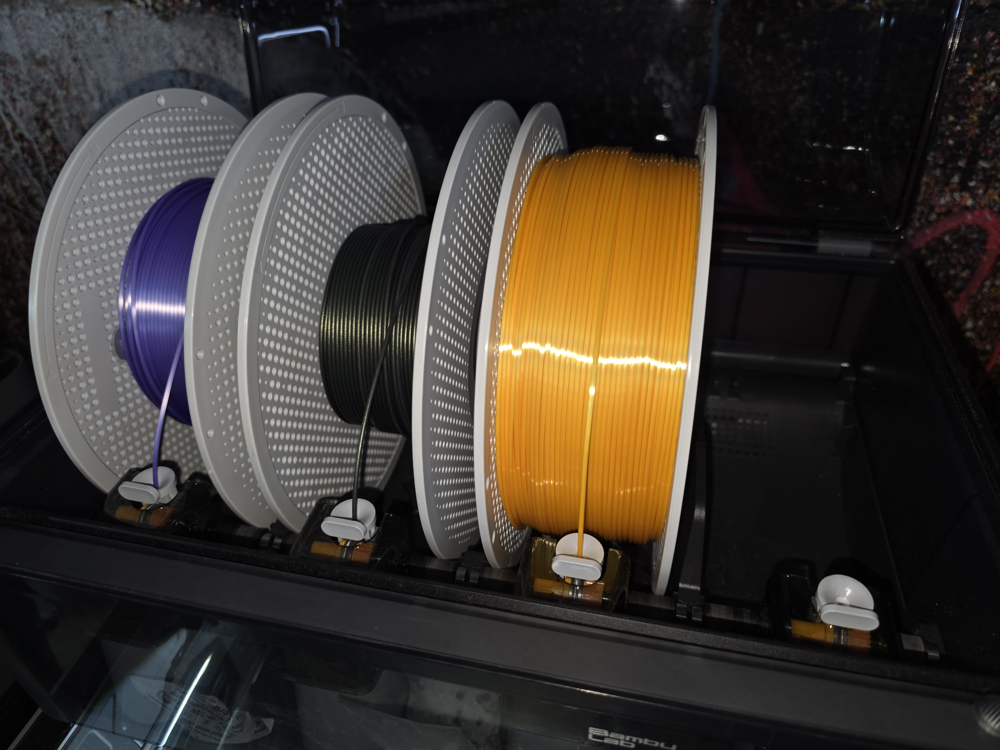
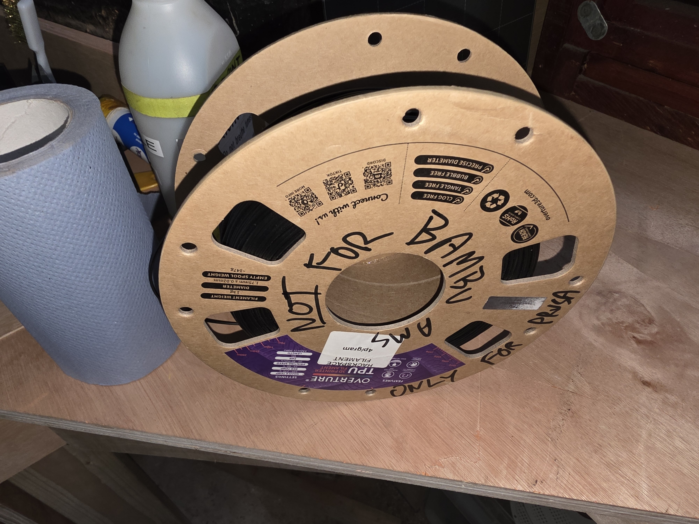
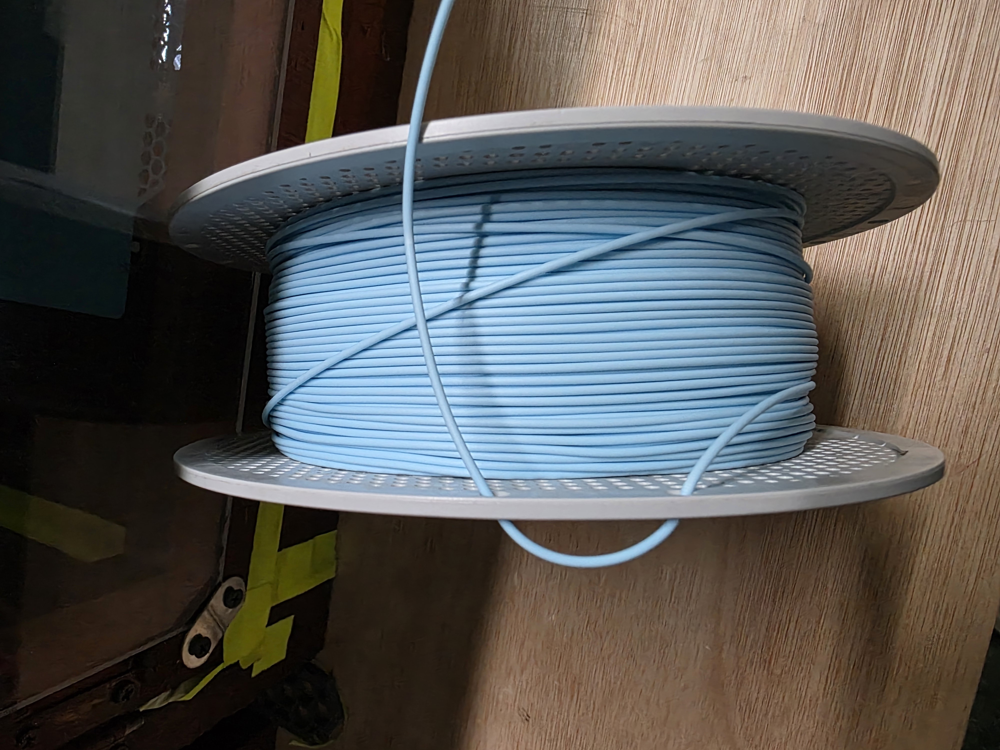

# Filament Guide

HacMan printers use 1.75 mm filament and hardened nozzles.

## Hackspace filament

Hackspace filament costs **4p per gram**. Payment is made through the Snackspace tuck shop and applies to all material used, including failed and cancelled prints.

<figure markdown="1">
  
  <figcaption>Pay for Hackspace filament through the Snackspace tuck shop.</figcaption>
</figure>

## Personal filament

You may bring compatible filament. Label it and remove it from the printer after use. Take it home or put it in your personal storage area if you have one; do not leave it on a printer or in the shared filament area. Secure the loose end before storage.

## Materials policy

| Material | Prusa MK4 | Bambu P1S/P2S |
|---|:---:|:---:|
| PLA | Yes | Yes |
| PETG | Yes | Yes |
| TPU | Yes | Yes, but only use TPU in the AMS if it is specifically marked as suitable for AMS use |
| ABS | No | Yes |
| ASA | No | Yes |
| Carbon/glass-fibre or glow composites | Yes | Yes, but check AMS suitability before using the AMS |
| Metal-filled filament | No | No |

ABS and ASA are restricted to the enclosed Bambu printers because they have carbon filtration. Ask the 3D printing team before using an unfamiliar material.

## Spools and storage

- Make sure the spool turns freely.
- Do not use a tangled or visibly damaged spool.
- Never put a bare cardboard spool directly in an AMS; use a suitable plastic spool or adapter rings.
- Do not force oversized, warped or poorly-wound spools into the AMS.
- AMS compatibility is stricter than printer compatibility. If a flexible, brittle, rough or fibre-filled filament does not feed smoothly, stop and ask before continuing.
- Secure the filament end in the spool holes or retaining clip whenever a spool is removed.
- Keep filament dry and clean.

<figure markdown="1">
  
  <figcaption>Spools in the AMS must sit correctly and rotate freely.</figcaption>
</figure>

<figure markdown="1">
  
  <figcaption>Do not place bare cardboard spools directly in the AMS. TPU must only be used in the AMS if it is specifically suitable for AMS use.</figcaption>
</figure>

<figure markdown="1">
  
  <figcaption>Secure the loose filament end before storing any spool.</figcaption>
</figure>
